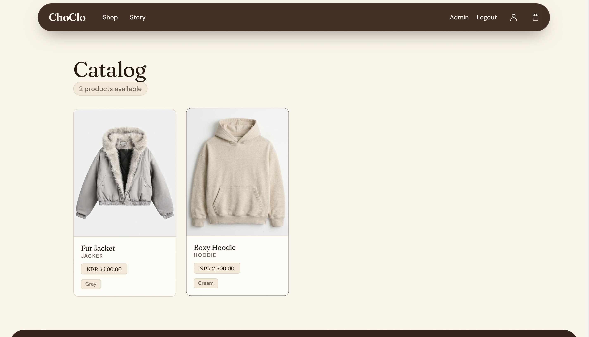
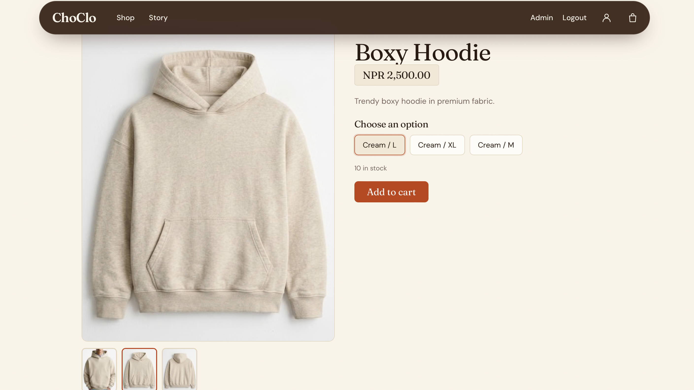
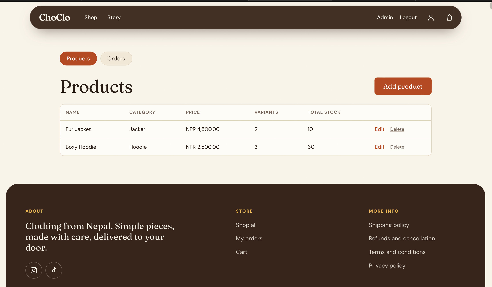
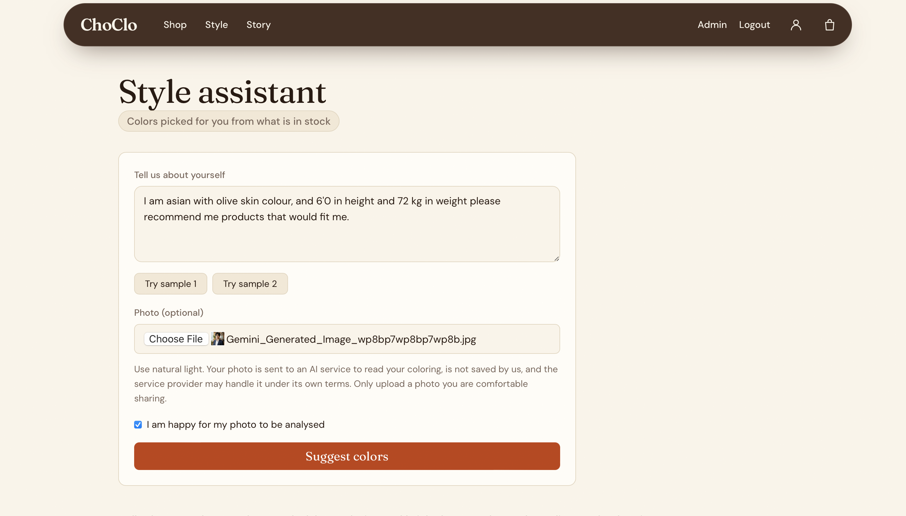
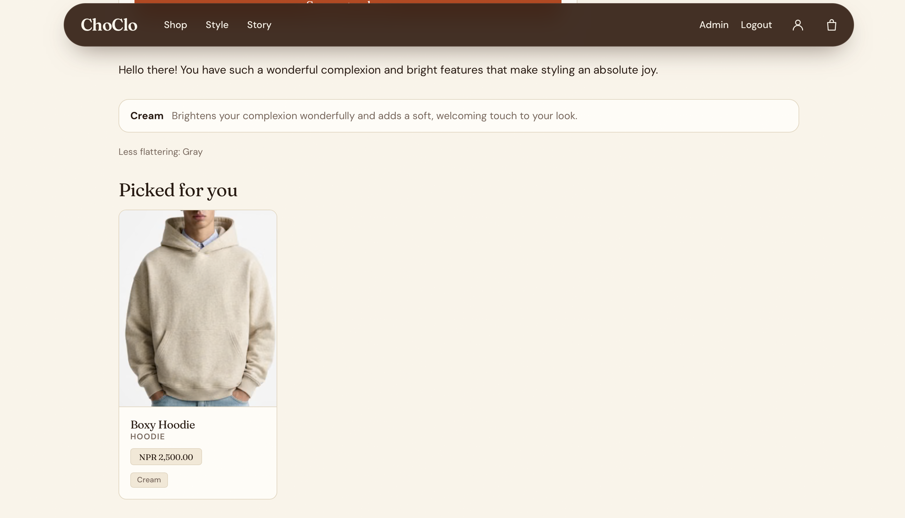

# ChoClo

A full-stack clothing store built from scratch: customers browse products, get AI-assisted style suggestions and size recommendations from product size charts, view products in 3D, pick a size and color, check out with cash on delivery, and follow their orders. Shop owners manage products, stock, images, 3D models and orders from an admin panel.

> **Live site:** [cho-clo.vercel.app](https://cho-clo.vercel.app)
> **Repository:** https://github.com/PrerakStha/ChoClo/








## Features

**Shop**
- Product listing with a main image and a second image that fades in on hover
- Product page with an image gallery, selectable size and color, and live stock
- Responsive home page with a header that changes as you scroll, and a footer with a live Nepal clock

**AI and 3D**
- Style suggestions from the Google Gemini API, based on a customer's description and, optionally, a photo they consent to share. Suggestions are limited to colors that are currently in stock.
- Size suggestions calculated by the server from the product's size chart, the customer's chest measurement, optional waist measurement, fit preference and available stock; this does not use Gemini.
- Interactive 3D product viewer built with Google's `model-viewer`; admins upload a GLB model for each product

Style photos are held in memory by the API for the request and are not saved by the app. They are sent to Google Gemini for analysis, so the provider may handle them under its own terms.

**Accounts**
- Register, log in and log out
- Passwords hashed with bcrypt
- Sessions use a signed JWT stored in an `httpOnly` cookie, so page scripts cannot read it

**Cart and checkout**
- Server-side cart per user (add, change quantity, remove)
- Checkout with shipping details and cash on delivery
- Orders are created in a database transaction: stock is checked and reduced in one step, so two customers cannot buy the last item
- Order history and an order confirmation page

**Admin panel** (admin accounts only)
- Create, edit and delete products with sizes, colors and stock
- Upload, reorder and delete product images (stored on Cloudinary) and attach GLB 3D models
- Manage categories
- View all orders and move them through statuses; cancelling an order returns its stock

## Tech stack

| Layer | Technology |
|---|---|
| Frontend | Next.js (App Router), React, plain CSS |
| Backend | Node.js, Express |
| Database | PostgreSQL (Neon) |
| ORM | Prisma 7 with the `pg` driver adapter |
| Validation | Zod |
| Auth | JWT in an `httpOnly` cookie, bcrypt |
| Recommendations | Google Gemini API for style suggestions; server-side size-chart logic for size suggestions |
| 3D | Google `model-viewer`, GLB models |
| Images | Cloudinary, multer |
| Hosting | Vercel (web) |

## Project structure

```
ChoClo/
├── api/
│   ├── prisma/             # schema, migrations, seed script
│   └── src/
│       ├── config/         # database and Cloudinary clients
│       ├── controllers/    # read the request, call a service, send the response
│       ├── middleware/     # auth, admin check, validation, file upload
│       ├── routes/
│       ├── services/       # business logic and database queries
│       ├── utils/
│       ├── validators/     # Zod schemas
│       └── server.js
└── web/
    └── src/
        ├── app/            # pages: shop, cart, checkout, orders, admin
        ├── components/
        ├── context/        # AuthContext, CartContext
        └── lib/            # API helper, formatting, image URLs
```

## Getting started

### Requirements
- Node.js (current LTS)
- A PostgreSQL database (a free Neon project works well)
- A Cloudinary account (for product images)
- A Google Gemini API key (for recommendations)

### 1. Clone and install

```bash
git clone https://github.com/PrerakStha/ChoClo.git
cd ChoClo

cd api && npm install
cd ../web && npm install
```

### 2. Environment variables

Create `api/.env`:

```
DATABASE_URL="postgresql://..."      # pooled connection, used by the running API
DIRECT_URL="postgresql://..."        # direct connection, used for migrations
JWT_SECRET="a long random string"
FRONTEND_URL="http://localhost:3000"
CLOUDINARY_CLOUD_NAME="..."
CLOUDINARY_API_KEY="..."
CLOUDINARY_API_SECRET="..."
GEMINI_API_KEY="..."
GEMINI_MODEL="gemini-2.5-flash"   # optional; this is the default
USER_LIMIT="1000"                 # optional daily in-memory AI request limit per user
GLOBAL_LIMIT="10000"              # optional daily in-memory AI request limit across this API process
```

Create `web/.env.local`:

```
NEXT_PUBLIC_API_URL=http://localhost:5000
```

Never commit these files.

AI request counters are held in the API process's memory. They reset daily and are not shared across multiple API instances.

### 3. Set up the database

```bash
cd api
npx prisma generate
npx prisma migrate dev
npx prisma db seed
```

### 4. Run it

In two terminals:

```bash
cd api && npm run dev     # http://localhost:5000
cd web && npm run dev     # http://localhost:3000
```

### 5. Create an admin account

Register a normal account on the site, then open `npx prisma studio` and change that user's `role` to `admin`. There is deliberately no public way to become an admin.

## API overview

| Area | Endpoints |
|---|---|
| Auth | `POST /api/auth/register`, `POST /api/auth/login`, `GET /api/auth/me`, `POST /api/auth/logout` |
| Products | `GET /api/products`, `GET /api/products/categories`, `GET /api/products/:slug` |
| Cart (login required) | `GET /api/cart`, `POST /api/cart/items`, `PATCH /api/cart/items/:id`, `DELETE /api/cart/items/:id` |
| Orders (login required) | `POST /api/orders`, `GET /api/orders`, `GET /api/orders/:id` |
| Recommendations | `POST /api/recommend/size` (size-chart based); `POST /api/recommend/style` (login required; description and/or optional photo) |
| Admin products (admin only) | `GET/POST /api/admin/products`, `GET/PUT/DELETE /api/admin/products/:id` |
| Admin variants (admin only) | `POST /api/admin/products/:id/variants`, `PATCH/DELETE /api/admin/variants/:id` |
| Admin categories (admin only) | `GET/POST /api/admin/categories` |
| Admin orders (admin only) | `GET /api/admin/orders`, `PATCH /api/admin/orders/:id/status` |
| Admin images (admin only) | `POST /api/admin/products/:id/images`, `PATCH /api/admin/products/:id/images/order`, `DELETE /api/admin/images/:id` |

## Design decisions

- **Prices are stored as integers in paisa**, never as floats, to avoid rounding errors. They are formatted for display only.
- **Orders keep a snapshot** of the product name, size, color and price at purchase time, so old orders stay correct when products change or are deleted.
- **Totals and prices are always calculated on the server** from database values. The client never sends a price.
- **Ownership checks:** cart items and orders are always looked up together with the logged-in user's id, so one user can never read or change another user's data. The user id comes from the verified token, never from the request body or URL.
- **Stock is reduced with a conditional update inside a transaction** (`stock >= quantity`), so the database decides who gets the last item.
- **JWT in an `httpOnly` cookie** instead of `localStorage`, so page scripts cannot directly read the token. The cookie is `Secure` in production and uses `SameSite=None` there to support cross-site frontend/API requests (`SameSite=Lax` in development).
- **Input validation with Zod** on API request bodies where applicable; unknown object fields are stripped by default.
- **Layered backend** (routes, controllers, services) so database code stays out of request handlers.

